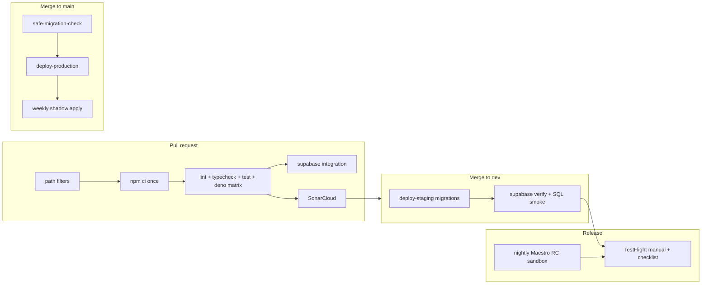

# KupaPay Pro v2 — implementation plan (architecture + quality gates)

**Status:** **Approved (Naveh, 2026-10-15)** — Phase 0 quality work may proceed; **no Pro v2 feature implementation until Phase 0 sign-off.**  
**Last updated:** 2026-10-15 (feature 6 recurring expenses + i18n phase + ads policy)  
**Scope:** Six Pro v2 features behind `EXPO_PUBLIC_KUPAPAY_PRO_ENABLED`, RevenueCat entitlement `pro`, and group Trip Pass (`group_passes`); **locales** HE+EN at launch, **Russian + Arabic (RTL)** in a later phase.  
**Related:** [PRO_FEATURES_PROPOSAL.md](PRO_FEATURES_PROPOSAL.md), [KUPAPAY_PRO_SETUP.md](KUPAPAY_PRO_SETUP.md), [SSOT/SUPABASE_ENVIRONMENTS.md](SSOT/SUPABASE_ENVIRONMENTS.md)

---

## Executive summary

Pro v2 adds **trip tooling** (FX view, reminders, insights, budget, receipt OCR, **recurring expenses**) without limiting free-tier splitting. **Monetization stays non-intrusive:** keep **rewarded ads only** (e.g. Remind to Settle Up via `AdOrGoProModal`); **no** interstitials, banners, or full-screen ad breaks on core flows — Pro removes rewarded gates via `shouldSkipAdGate`, not via new ad surfaces.

Shipping money-adjacent features requires **quality gates first**: payment webhook hardening, migration safety, RLS/integration tests, staging discipline, E2E purchase smoke, monitoring, and release checklists. **Features are phased only after Phase 0 (gates) is complete.**

Closed exploratory PRs (#128–#132) are superseded by this plan.

This document was stress-tested in **five explicit review loops** (see [Appendix — Review loops 1–5](#appendix--review-loops-15)) against the live repo workflows and target industry practice for **reliability, security, efficiency, scalability, flakiness, and maintainability**.

---

## Part 1 — Architecture (six features + shared platform)

### 1.1 Design principles

| Principle | Implication |
|-----------|-------------|
| **Free ledger stays unlimited** | Pro gates convenience/analytics/automation, not expense creation or balances. |
| **Single entitlement source of truth** | Server: `has_pro(user, group)` + `get_my_pro_status`. Client: cache via React Query; never infer Pro from UI flags alone. |
| **Master flag** | `EXPO_PUBLIC_KUPAPAY_PRO_ENABLED=false` by default → perks unlocked for all (same pattern as export gating today). |
| **Clean boundaries** | Domain math in `@cost-share/shared`; Supabase RPCs for authoritative aggregates; edge functions for cron/webhooks/OCR; mobile infrastructure for I/O. |
| **Offline-first honesty** | Pro features that need network show unavailable states; no fake “Pro active” UX when entitlement or FX cannot be verified. |
| **Cost awareness** | OCR and frequent cron jobs are bounded; analytics prefer SQL/materialized paths over repeated full-table client pulls. |
| **Ads** | **Rewarded-only** opt-in gates; never block expense creation or settlement with forced ads. |

### 1.2 Shared modules (target architecture)

```
┌─────────────────────────────────────────────────────────────────┐
│                        Mobile (Expo)                             │
│  proEntitlements.service ──► get_my_pro_status RPC               │
│  proGating (isProPerkUnlocked) ◄── shared hasPro helpers         │
│  fxRates.service (24h cache) ◄── useExchangeRatesQuery           │
│  reminderScheduler (client prefs + server cron)                    │
│  analytics UI ◄── RPCs / cached snapshots                        │
│  budget UI ◄── group budget RPC + local progress                   │
│  receiptScan ◄── edge receipt-ocr + draft parser                 │
└───────────────────────────┬─────────────────────────────────────┘
                            │ Supabase (authenticated + service_role)
┌───────────────────────────▼─────────────────────────────────────┐
│  RLS on groups, expenses, activity_events, pro tables            │
│  RPCs: has_pro, get_my_pro_status, set_* (Pro admin actions)     │
│  SQL views / RPCs: group_spending_* , pairwise debts (existing)  │
│  Cron edge: smart-reminder-dispatch, budget re-eval (optional)   │
│  Webhook: revenuecat-webhook (existing), send-push (existing)    │
└─────────────────────────────────────────────────────────────────┘
```

#### A. Entitlement / gating service

**Today:** `proEntitlements.service.ts`, `get_my_pro_status`, `has_pro`, `shouldSkipAdGate`, RevenueCat webhook → `profiles.pro_until`, `group_passes`.

**Target (Pro v2):**

| Layer | Responsibility |
|-------|----------------|
| **Shared** | `isProPerkUnlocked(hasPro, flag)`, `hasProFromTimestamps` — pure functions, unit-tested. |
| **Application** | `ProGatingPort`: `getProStatus(groupId?)`, `requirePro(groupId)` for use cases (export, scan, etc.). |
| **Infrastructure** | `proEntitlements.service` — RPC + RevenueCat refresh; React Query key `proStatus(groupId)`. |

**Rules:**

- Every Pro surface: `showUpsell = flag && !hasPro`; `featureEnabled = isProPerkUnlocked(hasPro, flag)`.
- Trip Pass: group-scoped `groupPassUntil` from RPC when `groupId` passed.
- Paywall: `featureKey` per surface for monetization analytics (existing pattern).

**No new entitlement types** for v2 unless owner adds B2B — reuse `pro` + Trip Pass.

#### B. FX rates service (caching)

**Today:** `exchangeRates.service.ts` — Open ER API + Frankfurter fallback, AsyncStorage 24h TTL; `useExchangeRatesQuery` with React Query staleTime 24h.

**Target:**

| Concern | Approach |
|---------|----------|
| **Trip currency view** | Convert pairwise debts client-side via `convertDebtsToTripCurrency(debts, target, rates)` (exists). |
| **Cache** | Keep 24h TTL; optional Supabase Edge cache later if rate limits bite — **not required for v2**. |
| **Offline** | Show last cached rates with “as of {date}” label; block conversion if no cache and offline. |
| **Security** | No API keys in client for public FX endpoints; no PII in rate requests. |

**Performance:** One query per `(base, symbols)` set per screen focus; dedupe via React Query keys (already).

#### C. Reminder / notification scheduler

**Today:** Manual remind — `send_settle_reminder` RPC → `activity_events` → `send-push`; push prefs in `notification_preferences`; `settle_up_reminder` kind.

**Target (smart reminders):**

| Component | Role |
|-----------|------|
| **Group settings** | `smart_reminder_interval_days` (≥3), enabled_by, last_run_at — Pro member configures. |
| **Anti-spam** | Per `(group_id, debtor_user_id)` last_sent_at; **hard floor 3 days** regardless of interval. |
| **Scheduler** | Daily edge `pro-smart-reminder-dispatch` (POST + `PUSH_WEBHOOK_SECRET`) → RPC `run_smart_payment_reminders`. |
| **Debt source** | Reuse pairwise debt math — service-role RPC mirroring `get_group_pairwise_debts` (no auth.uid() in cron). |
| **Delivery** | Reuse `settle_up_reminder` + `metadata.body` for digest text; WhatsApp = client share sheet (no server). |
| **In-app** | Activity feed + existing notification routing (`settleUpList` deep link). |

**RLS:** Only group members read reminder settings; only Pro users call `set_group_smart_reminder`; cron uses service_role.

#### D. Analytics aggregation (SQL views / RPCs)

**Today:** Client aggregates expenses for exports; no dedicated analytics RPCs.

**Target:**

| Deliverable | Implementation preference |
|-------------|---------------------------|
| **By category** | `get_group_spending_by_category(p_group_id, p_currency)` — SECURITY DEFINER, member check. |
| **By member (paid)** | `get_group_spending_by_member(p_group_id, p_currency)` — sum `expenses.amount` where `paid_by = member`. |
| **Over time** | Weekly buckets via `date_trunc('week', expense_date)` in SQL — avoids client timezone bugs. |
| **Optional materialized view** | `group_spending_daily_mv` refreshed on expense change — **only if** p95 latency > budget on large groups. |

**Client:** Thin hook `useGroupSpendingInsights(groupId, currency)` → RPC; chart UI renders bars only (no heavy chart library v1).

**Performance:** Index existing `expenses(group_id, is_deleted, expense_date, category)`; limit RPC to default currency first (multi-currency insights = v2.1).

#### E. Budget model

**Target schema (groups table or `group_trip_budgets` 1:1):**

| Column | Purpose |
|--------|---------|
| `trip_budget_amount` | NUMERIC > 0 |
| `trip_budget_currency` | VARCHAR(3) |
| `trip_budget_set_by` | UUID (Pro member who set) |
| `trip_budget_alert_80_sent` | boolean latch |
| `trip_budget_alert_100_sent` | boolean latch |

**Spend:** `SUM(expenses.amount)` where `group_id`, `currency = budget.currency`, `is_deleted = false`.

**Alerts:** After expense INSERT/UPDATE → `evaluate_trip_budget_alerts(group_id)` (SECURITY DEFINER). Insert `activity_events` kind `trip_budget_alert` for active members; reset latches when budget cleared/changed.

**Gating:** `set_group_trip_budget` requires `has_pro(auth.uid(), group_id)`; evaluation no-ops if Pro/Trip Pass expired for setter/group.

#### F. OCR pipeline

**Stages:**

1. **Capture** — existing `expo-image-picker` + receipt upload to `expense-receipts` bucket (private).
2. **OCR** — Supabase Edge `receipt-ocr`: JWT auth; accepts `text` (on-device OCR future) or `imageBase64`.
3. **Provider** — Optional `RECEIPT_OCR_API_URL` + `RECEIPT_OCR_API_KEY` (owner-supplied); **default: not configured**.
4. **Parse** — Shared heuristic `parseReceiptDraftFromText` (amount, currency, date, merchant) — unit tests in shared/mobile.
5. **Draft UX** — Pre-fill Add Expense; user always confirms before save.

**Security:** Edge function rate-limit per user; max payload size; no storage of images in function logs.

**Cost:** OCR external API per scan — Pro-gated; monitor invocations in Supabase dashboard.

#### G. Recurring expenses (Pro series)

**UX (Add Expense screen):**

| Control | Placement | Behavior |
|---------|-----------|----------|
| **Recurring toggle** | Bottom row alongside **receipt** and **date** controls | Pro-gated when `EXPO_PUBLIC_KUPAPAY_PRO_ENABLED`; upsell when locked |
| **Start date** | Reuse existing **date picker** (same component as expense date) | First occurrence date; timezone = user/device local, stored as `DATE` |
| **Frequency** | Segmented control or picker | `weekly` \| `monthly` \| `yearly` |
| **Series actions** | Expense detail / edit flow | **Edit series** (amount, splits, category, frequency, end date) vs **this occurrence only**; **Stop series** sets `ended_at` |

**Server:**

| Component | Role |
|-----------|------|
| **`recurring_expense_series`** | `group_id`, template fields (amount, currency, splits JSON, category, paid_by, description), `frequency`, `start_date`, `next_run_date`, `ended_at`, `created_by`, `timezone` hint |
| **`recurring_expense_occurrences`** | Optional link `expense_id` ↔ `series_id` + `scheduled_for` for idempotency audit |
| **Generator RPC** | `generate_due_recurring_expenses(p_limit)` — SECURITY DEFINER, service_role/cron only; inserts `expenses` from due series; advances `next_run_date`; **idempotent** on `(series_id, scheduled_for)` unique constraint |
| **Cron edge** | `pro-recurring-expense-dispatch` — daily POST + `PUSH_WEBHOOK_SECRET`; **advisory lock** (or `pg_try_advisory_lock`) so overlapping runs do not double-create |
| **Member RPCs** | `create_recurring_expense_series`, `update_recurring_expense_series`, `stop_recurring_expense_series` — require `has_pro(auth.uid(), group_id)` + membership |

**Rules:**

- Generation runs server-side only (client may preview next dates locally for UX, not authoritative).
- Stopping a series does not delete past generated expenses.
- Bulk cron uses **batch `LIMIT`** (same pattern as smart reminders §1.9).

**i18n:** Copy for frequency labels and series edit/stop flows must use i18next keys from day one (EN/HE); **Russian + Arabic** ship in Phase 7.

### 1.3 Feature specs (concise)

| # | Feature | Primary UI | Server | Existing building blocks |
|---|---------|------------|--------|---------------------------|
| 1 | **Trip currency view** | Group detail or Balances | FX client-only | `GroupTripCurrencySection`, `tripCurrencyConversion`, `useExchangeRatesQuery` |
| 2 | **Smart payment reminders** | Settle Up list | Migration + cron RPC | `send_settle_reminder`, push pipeline, `get_group_pairwise_debts` |
| 3 | **Spending insights** | Group menu sheet | Analytics RPCs | Categories on `expenses`, group expenses query |
| 4 | **Trip budget + alerts** | Group detail | Budget RPC + trigger | Group totals patterns, `activity_events`, push kinds |
| 5 | **Receipt OCR** | Add expense receipt menu | `receipt-ocr` edge | Receipt upload, Add Expense form |
| 6 | **Recurring expenses** | Add expense footer (toggle + frequency) | Series table + daily cron RPC | Add Expense form, date picker, expense insert patterns |

### 1.4 Data model & migrations (planned)

All migrations: idempotent patterns, `-- safe-breaking:` annotations where REVOKE/DROP CONSTRAINT, **dev first** (`drxfbicunusmipdgbgdk`), production via `deploy-production.yml` after validation.

| Migration theme | Objects |
|-----------------|--------|
| Smart reminders | `groups.smart_reminder_*`, `group_smart_reminder_recipient_state`, RPCs `set_group_smart_reminder`, `run_smart_payment_reminders` |
| Analytics | RPCs only (no new tables v1) |
| Budget | `groups.trip_budget_*`, `trip_budget_alert` activity kind, trigger on `expenses` |
| OCR | No DB schema required v1; optional `receipt_ocr_audit` table later for support |
| Recurring expenses | `recurring_expense_series`, optional `recurring_expense_occurrences`, RPCs + idempotency unique index |

**RLS:** New tables member-read; writes via SECURITY DEFINER RPCs only. Cron functions **service_role only**.

### 1.5 Edge functions

| Function | Auth | Schedule |
|----------|------|----------|
| `revenuecat-webhook` | Shared secret | RevenueCat POST |
| `send-push` | Webhook secret | DB trigger |
| `pro-trial-reminder-dispatch` | Webhook secret | Daily cron |
| `pro-smart-reminder-dispatch` | Webhook secret | Daily cron |
| `receipt-ocr` | User JWT | On demand |
| `pro-recurring-expense-dispatch` | Webhook secret | Daily cron |

Deploy checklist per function: secrets documented in `KUPAPAY_PRO_SETUP.md` / `RECEIPT_OCR.md`.

### 1.6 Client state & offline

| Feature | Online | Offline |
|---------|--------|---------|
| Trip currency | Live rates or cached FX | Cached rates only; upsell if locked |
| Smart reminders | Configure interval | Show last known setting; queue RPC on reconnect |
| Insights | RPC fetch | Hide or “offline” if no cached snapshot (v1: hide) |
| Budget | Edit budget + live progress | Show last budget; progress stale |
| Receipt scan | Edge OCR | Camera + attach photo; OCR when online |
| Recurring series | Configure / stop series | Show last template; no generation offline |

React Query: invalidate pro status after purchase restore; invalidate group on budget/reminder settings change.

### 1.7 Performance budgets (initial)

| Operation | Target (p95) |
|-----------|----------------|
| `get_my_pro_status` | < 200 ms |
| Analytics RPC (≤5k expenses/group) | < 500 ms |
| Trip currency conversion (client) | < 50 ms |
| Receipt OCR edge (excl. provider) | < 3 s |

Load-test analytics RPC on dev with seeded large group before prod.

### 1.8 Security summary

- Pro admin RPCs: `has_pro` + `is_group_member`.
- Cron: no member impersonation; actor on reminders = `smart_reminder_set_by`.
- OCR: authenticated only; size limits; optional provider keys in Supabase secrets only.
- No PII in push metadata beyond existing patterns.
- Trip Pass: continue webhook idempotency (`revenuecat_webhook_events` pattern).

### 1.9 Reliability, scalability & maintainability (architecture)

| Topic | v2 target (industry-aligned) |
|-------|------------------------------|
| **Cron dispatch** | Idempotent daily runs; **batch groups** with `LIMIT`/cursor in RPC (avoid single long transaction); advisory lock or `FOR UPDATE SKIP LOCKED` so overlapping cron invocations do not double-send. |
| **Pairwise debt SQL** | One internal `*_pairwise_debts_core(group_id)` function; cron, reminders, and member RPC call it — no copy-paste drift (Sonar CPD already excludes migrations; logic duplication still a bug source). |
| **Budget trigger** | Fire on expense change but **debounce** via `pg_notify` + small worker or evaluate only when `amount/currency/is_deleted` change; document max trigger frequency under bulk import. |
| **Analytics RPCs** | `SET LOCAL statement_timeout = '5s'` inside RPC; return partial error to client; add composite index `(group_id, currency, is_deleted, expense_date)` if explain plans require. |
| **Pro status cache** | React Query `staleTime` 2–5 min for `get_my_pro_status`; invalidate on purchase, restore, foreground after paywall — reduces RPC load at scale. |
| **FX cache** | Keep client 24h cache; document **staleness UX** (“Rates as of …”); optional single edge cache only if Open ER rate limits become measurable. |
| **OCR** | Max image size (e.g. 2 MB base64); timeout 10s; **queue depth limit** per user/day in edge or DB counter; cold-start acceptable for Pro-only path. |
| **Activity kinds** | Any new kind requires coordinated change: DB CHECK → `@cost-share/shared` `ActivityEventKind` → `send-push` render + prefs map → mobile activity card routing (checklist in Phase 0). |
| **Observability** | Structured logs from edge handlers (`event_id`, `group_id`, counts); no raw receipt bytes in logs. |

---

## Part 2 — Quality gates (before real payments & Pro v2 users)

**Goal:** No broad Pro v2 rollout until these gates are **defined, automated where possible, and green on `dev` for two consecutive release cycles.**

### 2.1 Current CI/CD audit (as of 2026-10-15, verified against repo)

#### Workflow inventory

| Workflow file | Trigger | Concurrency | Secrets / env | Primary outcome |
|---------------|---------|-------------|---------------|-----------------|
| `ci.yml` | PR → `dev`, `main`, `cursor/**` | `cancel-in-progress: true` per PR | `GITHUB_TOKEN`, `ADMIN_PAT` (dev bump) | Lint, typecheck, Jest, RC Deno test; auto-merge to `dev` |
| `deploy-staging.yml` | Push `dev` (migration paths) | Serialized staging deploy | `SUPABASE_DEV_DB_PASSWORD` | `supabase db push` → development project |
| `deploy-production.yml` | Push `main` (migration paths) | Serialized prod deploy | GitHub Environment **Production**, `SUPABASE_PROD_DB_PASSWORD` | Safe-migration check → `db push` → production |
| `testflight-ios.yml` | Manual only | Cancel in progress | ASC + Expo + RC iOS key | Local EAS iOS build + TestFlight submit |
| `bump-version-main.yml` | Manual only | Serialized | `ADMIN_PAT` | Semver bump on `main` |

**External (not in repo YAML):** SonarCloud analysis on PRs (`sonar-project.properties` excludes migration SQL from CPD); Vercel preview deployments (four projects observed on PRs — web/mobile variants).

#### Job-level findings (reliability, security, efficiency)

| Area | Current behavior | Gap / risk |
|------|------------------|------------|
| **Install efficiency** | `lint`, `typecheck`, and `test` are **separate jobs**, each runs full `npm ci` | ~3× install time and cache churn; slower feedback, higher Actions minutes |
| **Lint scope** | `turbo run lint` — pipeline only defines `lint` for packages; web/mobile lint may be **no-op at root** if tasks empty | False confidence if Turbo runs 0 tasks; needs explicit per-workspace lint or unified job |
| **Typecheck scope** | `shared` + `mobile` only | Web and **all** `supabase/functions/**` Deno TS not typechecked in CI |
| **Deno coverage** | Only `revenuecat-webhook/` tested | `send-push`, trial/smart crons, future `receipt-ocr` untested → regression risk on payment/push paths |
| **Auto-merge vs Sonar** | `auto-merge` `needs:` **does not include** SonarCloud | Comment in workflow mentions Sonar for `dev` pushes, but bot can enable auto-merge before Sonar finishes → **flaky gate** |
| **Auto-merge vs typecheck** | Included in `needs` | Good |
| **PR cancel-in-progress** | New push cancels in-flight CI | Saves minutes but causes **red herring** cancellations; re-run confusion |
| **Migration deploy** | `supabase-ci-db-push.sh` does dry-run repair hint + push; documents past `migration repair` incident | No post-push **`supabase:verify`** or SQL smoke; no automatic rollback |
| **Safe migration check** | Regex on **new** files only; skipped when `GITHUB_EVENT_BEFORE` empty (manual prod deploy) | Ops bypass path must be rare and logged |
| **Production gate** | GitHub Environment `Production` on migrate job | Good; validate-migrations job has **no** environment (intentional — no prod secrets) |
| **TestFlight** | `sync-eas-ios-build-number.mjs \|\| true` | Silent failure can produce **wrong build number** / upload flake |
| **TestFlight deps** | `npm ci --ignore-scripts` | Faster but skips postinstall integrity hooks — supply-chain tradeoff |
| **Fork PRs** | CI runs on `cursor/**` | Secrets not exposed to forks, but **untrusted code** runs in CI — limit permissions (already minimal for GITHUB_TOKEN) |
| **Dev version bump** | `ADMIN_PAT` push bypasses required checks on `dev` | Documented tradeoff for version.json races; PAT rotation + audit required |

**Branch protection (inferred):** `dev` — Lint + Mobile tests required; Sonar often reported on PRs but **not wired into auto-merge**. `main` — manual merge; migration deploy on push.

### 2.2 Proposed quality gate program

#### Gate A — Unit tests

| Area | Requirement |
|------|-------------|
| Shared | 100% coverage on `hasPro*`, trip currency math, receipt parser, budget percent |
| Mobile | Component tests for each Pro surface (locked vs unlocked, RTL smoke) |
| Edge | Deno tests for every edge function handler (inject deps pattern like `pro-trial-reminder-dispatch`) |

**CI implementation (efficiency + reliability):**

- **Single `setup` job:** one `npm ci`, upload `node_modules` + turbo cache artifact; downstream lint/typecheck/test **reuse** (or use Turborepo remote cache + `turbo run lint typecheck test --filter=...` in one job with parallel steps).
- **`deno-test` matrix job** (parallel shards): `revenuecat-webhook`, `send-push`, `pro-trial-reminder-dispatch`, `pro-smart-reminder-dispatch`, `receipt-ocr` — each `deno test --allow-env`; fail fast within shard, not across unrelated functions.
- **Coverage:** Jest `--coverage` with **70% line** floor on `packages/shared` and `apps/mobile/lib` (ratchet +5% per quarter); upload to Sonar or Codecov for trend only — **do not** block on coverage oscillation until baseline stable.
- **Flake control:** Jest `--ci` with limited workers; retry **once** only for known timer flakes; ban `waitFor` without `timeout` in new tests.

#### Gate B — Integration tests (Supabase local + RLS)

**Today:** `cost-share-app/supabase/__tests/*.test.sql` exist but **are not run in CI**.

**Target:**

1. **Path-filtered job** `supabase-integration` — runs only when `cost-share-app/supabase/migrations/**`, `functions/**`, or `__tests__/**` change (saves ~8–12 min on UI-only PRs).
2. Use `supabase start` + `supabase db reset` locally in CI (pin CLI version to match `config.toml`); apply migrations + run all `supabase/__tests__/*.test.sql` via scripted psql or `supabase test db`.
3. **RLS suites** for new Pro RPCs: non-member denied, member without Pro denied on setters, member with Pro allowed, service_role cron allowed.
4. Post-deploy on **staging** (dev project): run same SQL suite + `npm run supabase:verify` against linked dev after `deploy-staging` (new job `needs: supabase-migrations`).

**Acceptance:** Migration PR cannot merge without green SQL integration job; staging deploy cannot complete without verify step green.

#### Gate C — Payment webhook contract tests

**Extend** `revenuecat-webhook/handler.test.ts`:

- Golden fixtures for: initial purchase, renewal, cancellation, Trip Pass with `group_id`, duplicate event id (idempotency), invalid signature.
- Assert RPC payload shapes match migration-defined functions.

**Optional:** Pact or snapshot HTTP tests against local edge serve.

#### Gate D — E2E tests (Maestro or Detox)

**Scope v1:** RevenueCat **sandbox** — not production payments.

| Flow | Tool | Notes |
|------|------|-------|
| Open paywall from locked export | Maestro | `EXPO_PUBLIC_KUPAPAY_PRO_ENABLED=true` dev build |
| Restore purchases (sandbox account) | Maestro | StoreKit configuration / RC sandbox user |
| Trip Pass attribute + group unlock | Maestro + seeded dev user | Verify `get_my_pro_status` UI badge |

Detox alternative if team prefers JS driver — pick **one** tool to avoid duplication.

**CI:** Scheduled workflow `e2e-pro-sandbox.yml` — cron `0 4 * * *` on `dev` (Maestro Cloud or self-hosted macOS); **concurrency 1** to avoid ASC/RC rate limits; upload artifacts (video + logs). PRs: run **smoke subset** only when `apps/mobile/**` and label `e2e` present (cost control).

#### Gate E — Migration safety

**Existing:** `supabase-safe-migration-check.sh` on production deploy (regex + `-- safe-breaking` escape).

**Add:**

| Step | Description |
|------|-------------|
| **Shadow schema** | Weekly job: restore prod schema snapshot to ephemeral DB (or Supabase branch), apply pending migrations from `dev`, run SQL integration suite |
| **Dry-run report** | Post PR comment with tables/columns added, new RPCs, new activity kinds |
| **Rollback plan** | Each Pro migration PR includes markdown rollback (drop trigger → drop RPC → drop columns) — forward-only preferred; document data loss |

**Manual dispatch warning:** Document that `workflow_dispatch` skips “new files” detection when `GITHUB_EVENT_BEFORE` empty — **require** explicit `MIGRATION_FILES` input or run full safe-check against all pending migrations when dispatching prod deploy.

**Prod shadow DB (weekly):** Supabase **branch** or pg_dump schema-only from prod → ephemeral DB → apply `dev` migration delta → run SQL integration suite; store log artifact 30 days.

#### Gate F — Staging environment

| Env | Branch | Supabase | Mobile build |
|-----|--------|----------|--------------|
| **Development** | `dev` | `drxfbicunusmipdgbgdk` | Dev client / internal |
| **Staging** | Tag or `release/*` | Same as dev **or** dedicated staging project (open question) | TestFlight with RC sandbox |
| **Production** | `main` | `jfqxjjjbpxbwwvoygahu` | App Store |

**Gate:** Pro v2 features enabled on staging builds for 1+ week before prod flag flip.

#### Gate G — Branch protections & required checks

**Recommend for `main`:**

- Required: Lint, Typecheck, Mobile tests, SonarCloud (quality gate pass), SQL integration (when migrations change), RevenueCat webhook Deno tests.
- Require PR review from owner for migration + payment touches.
- Block force-push.

**For `dev`:** Auto-merge `needs` must include **SonarCloud** (quality gate passed) and `supabase-integration` when migration paths change; use `gh pr merge --auto` only after required checks (or switch to merge queue if GitHub plan allows).

#### Gate H — Coverage & Sonar

- Document Sonar quality gate in repo (`docs/SSOT/CODE QUALITY.md` pointer).
- Fail PR if duplication > threshold on copied SQL debt logic — extract shared SQL function for pairwise debts once.

#### Gate I — Release gates (TestFlight smoke checklist)

Manual checklist before promoting `EXPO_PUBLIC_KUPAPAY_PRO_ENABLED=true` on production build:

- [ ] Sign in (Google + Apple sample accounts)
- [ ] Paywall loads prices; Terms/Privacy links work
- [ ] Sandbox purchase → Pro unlocks export PDF
- [ ] Restore purchases
- [ ] Trip Pass purchase → group members see Pro (dev group)
- [ ] Webhook received (RC dashboard + `profiles.pro_until` row)
- [ ] Push token registered; test settle reminder still works
- [ ] Hebrew RTL: paywall + one Pro surface
- [ ] Offline: add expense still works; Pro surfaces degrade gracefully

Attach checklist to TestFlight workflow artifact or `docs/TESTFLIGHT_GITHUB_ACTIONS.md`.

#### Gate J — Monitoring & alerting

| Signal | Tool | Alert |
|--------|------|-------|
| Mobile crashes | Sentry (existing mock in Jest) | New release regression |
| Webhook failures | Supabase function logs + Sentry edge | Pager/email to owner |
| Webhook lag | RC dashboard + DB `revenuecat_webhook_events` stuck | Daily cron review |
| OCR cost | Supabase invocations metric | Budget alert |
| Cron silent failure | `pro-*-dispatch` returns 5xx | Log drain → email |

**Require:** RevenueCat webhook 4xx/5xx dashboard check in incident runbook.

#### Gate K — Incident runbook (payments)

1. **Detect:** User report / RC webhook errors / entitlement mismatch.  
2. **Triage:** Compare RC customer → Supabase `profiles.pro_until` / `group_passes`.  
3. **Mitigate:** Disable Pro flag in EAS env (instant kill switch); keep free tier usable.  
4. **Fix forward:** Replay webhook event id if idempotent handler allows; manual SQL only with owner on prod.  
5. **Communicate:** In-app banner if widespread; App Store refund policy link.  
6. **Post-mortem:** Update `KNOWN_ISSUES.md` + test fixture.

### 2.3 Target CI/CD architecture (industry-standard end state)



| Principle | Target |
|-----------|--------|
| **Speed** | Median PR feedback < 12 min (p95 < 20 min) via single install + path filters + parallel Deno matrix |
| **Reliability** | No auto-merge until **all** required checks green; staging verify catches migration drift |
| **Security** | Production deploy only via Environment; rotate `ADMIN_PAT`; separate webhook secrets per cron optional; Dependabot + `npm audit` advisory job |
| **Cost** | E2E nightly not per-PR; Supabase CI only on DB paths; Vercel previews unchanged (advisory) |
| **Maintainability** | `CODEOWNERS` for `supabase/migrations`, `supabase/functions`, `.github/workflows`; one `scripts/ci-deno-test-all.sh` entry point |

---

## Part 3 — Phased milestones (quality first)

### Phase 0 — Quality foundation (BLOCKING)

**Acceptance criteria:**

- [ ] **CI efficiency:** Single-install workflow (or measured ≥40% reduction in total `npm ci` time vs baseline).
- [ ] **Auto-merge integrity:** `dev` auto-merge waits for SonarCloud + typecheck + SQL job when applicable.
- [ ] SQL integration tests run in CI on migration changes; all existing `supabase/__tests__` included.
- [ ] Deno matrix covers `send-push`, `revenuecat-webhook`, and template for all new Pro edge functions.
- [ ] Webhook contract test suite covers idempotency + Trip Pass + invalid auth.
- [ ] Staging deploy runs `supabase:verify` + SQL smoke post-push.
- [ ] Documented TestFlight smoke checklist executed once on `dev`; remove `\|\| true` from build-number sync or fail loudly.
- [ ] Sentry release tracking wired for mobile production builds; edge function error sampling enabled.
- [ ] Owner sign-off on branch protections and Sonar quality gate policy (documented in SSOT).
- [ ] Shadow migration dry-run executed once with logged artifact.
- [ ] `CODEOWNERS` + activity-kind change checklist merged.

**No Pro v2 feature code merges to `main` until Phase 0 sign-off.**

### Phase 1 — Trip currency view

**Depends on:** Phase 0.

**Deliverables:** Mount `GroupTripCurrencySection`; gating + paywall; FX offline behavior; EN/HE tests.

**Acceptance:**

- [ ] Multi-currency group shows conversion for Pro; upsell when flag on and not Pro.
- [ ] Single-currency group hides section when unlocked.
- [ ] Rates missing / offline copy verified.

### Phase 2 — Smart payment reminders

**Deliverables:** Group settings UI, migration, cron deploy doc, anti-spam tests, WhatsApp share.

**Acceptance:**

- [ ] Debtor receives ≤1 automated reminder per 3 days.
- [ ] Group interval respected.
- [ ] Stops when Pro/Trip Pass lapses.
- [ ] Push + in-app activity visible; deep link opens Settle Up.

### Phase 3 — Spending insights

**Deliverables:** SQL RPCs, sheet UI, default-currency scope documented.

**Acceptance:**

- [ ] Charts match SQL totals for seeded fixture group.
- [ ] Non-Pro sees upsell only when flag enabled.
- [ ] p95 RPC within budget on 5k expenses (dev load test).

### Phase 4 — Trip budget + alerts

**Deliverables:** Budget editor, trigger, new activity kind, send-push renderers, latch reset on budget change.

**Acceptance:**

- [ ] 80% and 100% fire exactly once per budget configuration.
- [ ] Push received by all active members (prefs permitting).
- [ ] Changing budget resets latches.

### Phase 5 — Receipt OCR

**Deliverables:** Edge function, parser tests, optional provider doc, Pro scan entry on Add Expense.

**Acceptance:**

- [ ] Without provider keys: photo saved, user informed, manual entry.
- [ ] With fixture text: draft fields pre-filled correctly (EN/HE receipts sample set).
- [ ] Rate limit prevents abuse.

### Phase 6 — Recurring expenses (Pro)

**Depends on:** Phase 5.

**Deliverables:** Series schema + RPCs, `pro-recurring-expense-dispatch` cron, Add Expense footer UI (toggle + frequency + start date), edit/stop series flows, EN/HE strings.

**Acceptance:**

- [ ] Pro user can start weekly/monthly/yearly series from Add Expense.
- [ ] Cron creates expenses idempotently (no duplicates on re-run / overlapping cron).
- [ ] Stop series prevents future generation; past expenses remain.
- [ ] Edit series updates template; optional “this occurrence only” documented in UX.
- [ ] Non-Pro sees upsell when master flag on.

### Phase 7 — i18n expansion (Russian + Arabic RTL)

**Depends on:** Phase 6 (or parallel late Phase 5 if strings-only prep).

**Deliverables:** `ru` and `ar` locale files (mobile + shared copy); RTL layout audit for Arabic (reuse existing RTL infrastructure from Hebrew); push/send-push locale strings where applicable; store listing copy coordination.

**Acceptance:**

- [ ] Language switcher includes RU + AR; Arabic forces RTL.
- [ ] Critical flows (auth, add expense, settle up, paywall, Pro surfaces) translated.
- [ ] No new intrusive ad formats introduced during localization.

### Phase 8 — Production Pro v2 launch

**Acceptance:**

- [ ] All phases on `dev` for ≥1 week stable.
- [ ] Migrations applied to prod with safe-check green.
- [ ] `EXPO_PUBLIC_KUPAPAY_PRO_ENABLED=true` on production EAS env.
- [ ] TestFlight smoke on prod RC keys.
- [ ] Monitoring dashboards active.

---

## Part 4 — Risks & open questions

### Risks

| Risk | Impact | Mitigation |
|------|--------|------------|
| **Webhook misconfiguration** | Paid users not unlocked | Contract tests + RC dashboard alerts + kill switch flag |
| **Cron over-notification** | User trust loss | 3-day floor, opt-in interval, easy Off |
| **FX API outage** | Trip currency wrong/missing | Cache + honest empty state |
| **OCR cost / abuse** | Bill shock | Pro gate, rate limits, optional provider |
| **Analytics on large groups** | Slow screens | SQL aggregation, indexes, pagination |
| **Migration on prod** | Old app breakage | safe-migration-check + shadow DB |
| **Sonar / Vercel noise** | Blocked merges | Sonar required on `dev`; Vercel advisory only |
| **Auto-merge race** | Merge before Sonar/SQL | Fix `needs` graph + merge queue |
| **CI cost / slow feedback** | Owner frustration | Path filters + single install |
| **Cron duplicate sends** | Spam / trust | Advisory locks + idempotent RPC |
| **Duplicate `isProPerkUnlocked` across PRs** | Merge conflicts | Single shared PR first in Phase 1 |

### Open questions (owner / Naveh)

1. **Staging Supabase:** Separate project vs shared dev for pre-prod QA?  
2. **Smart reminders:** Legal/copy review for automated debt messages (HE/EN)?  
3. **Budget alerts:** Push to all members vs payer subset only?  
4. **Insights:** Default currency only v1 — confirm OK for multi-currency trips.  
5. **OCR vendor:** On-device ML Kit vs cloud-only vs hybrid? Budget for API?  
6. **Android Pro:** Parity timeline for Play Billing + RC sandbox E2E.  
7. **Coverage threshold:** Agree on 70% vs 80% for gate enforcement.  
8. **Maestro vs Detox:** Tool choice and cloud budget.  
9. **Trip Pass pricing:** Still TBD in store — blocks marketing copy finalization.  
10. **Phase 0 deadline:** Target sign-off date to start Phase 1 implementation?  
11. **Merge queue:** Enable GitHub merge queue on `dev` vs PAT auto-merge?  
12. **Separate cron secrets:** Single `PUSH_WEBHOOK_SECRET` vs per-function rotation?

---

## Appendix — Review loops 1–5

Each loop re-read **Part 1 (architecture)** and **Part 2 (CI/CD)** against the repo (`.github/workflows/*`, `scripts/supabase-*.sh`, `sonar-project.properties`) and updated the plan.

### Review loop 1 — Reliability & flakiness

**Findings**

- Auto-merge does not wait for SonarCloud → merges can land with quality gate failing.
- CI `cancel-in-progress: true` aborts runs on every push → noisy failures.
- TestFlight build-number sync uses `|| true` → silent mis-versioning.
- Migration deploy has no post-push schema verify → historical `migration repair` class of bugs can recur silently.
- Budget trigger design could fire excessively on bulk expense edits.

**Changes made**

- Documented auto-merge / Sonar gap; Phase 0 requires fixing `needs` graph.
- Added staging post-deploy `supabase:verify` + SQL smoke.
- Phase 0: fail-loud build-number sync; cron RPC batching + advisory locks in §1.9.
- Recommended merge queue or Sonar in `needs` for `dev`.

### Review loop 2 — Security

**Findings**

- `ADMIN_PAT` bypasses branch protection for version bumps — high privilege.
- Shared `PUSH_WEBHOOK_SECRET` across multiple crons — blast radius if leaked.
- Production deploy correctly uses GitHub Environment; validate job stays secretless.
- `cursor/**` PRs run CI on potentially untrusted code — keep minimal `permissions`.
- OCR edge must enforce auth, size limits, and per-user quotas.

**Changes made**

- Gate J/K expanded; OCR security in §1.9; optional per-function cron secrets in open questions.
- Phase 0: PAT rotation policy; Dependabot/advisory job in §2.3.
- Webhook contract tests must include invalid auth (Gate C).

### Review loop 3 — Efficiency, speed & cost

**Findings**

- Triple `npm ci` on every PR dominates wall-clock and Actions minutes.
- Supabase local CI expensive — must be path-filtered.
- Full E2E on every PR is cost-prohibitive; nightly + label-gated is standard.
- Turbo lint may execute zero tasks — wasted job.
- Four Vercel previews per PR add noise (not mobile Pro relevant).

**Changes made**

- Gate A: single-install / Turborepo pattern; Deno parallel matrix.
- Gate B: path filters; Gate D: nightly + optional `e2e` label.
- §2.3 SLO: median PR feedback < 12 min.
- Audit table notes Turbo lint no-op risk — Phase 0 fix.

### Review loop 4 — Scalability (architecture)

**Findings**

- Full-table cron scans over all groups will not scale.
- Client-side analytics aggregation does not scale; SQL RPCs required.
- Duplicate pairwise-debt SQL across RPCs is a maintenance and correctness hazard.
- Pro status refetch on every screen focus could amplify RPC load.

**Changes made**

- §1.9: batched cron, shared debt core function, statement timeouts, Pro cache staleTime.
- Analytics materialized view trigger only if load test fails (clearer escalation path).
- Index recommendation documented.

### Review loop 5 — Maintainability & industry alignment

**Findings**

- Edge functions lack unified test entry script — drift likely as Pro adds crons/OCR.
- New activity kinds touch 4+ layers — easy to miss send-push or mobile routing.
- Workflow inventory was incomplete in v1 draft (bump-version, concurrency, secrets).
- Phase 0 acceptance criteria were not measurable.

**Changes made**

- Full workflow inventory table (§2.1).
- §2.3 target diagram + `CODEOWNERS` + `ci-deno-test-all.sh`.
- Activity-kind coordination checklist in §1.9.
- Phase 0 criteria made measurable (CI time reduction, explicit checks).

---

## Appendix — Implementation PR order (after approval)

1. Phase 0 quality PRs (CI jobs, SQL test runner, docs).  
2. Phase 1 trip currency (single focused PR).  
3. Phase 2 reminders (migration + edge + mobile).  
4. Phase 3 insights (RPC + mobile).  
5. Phase 4 budget (migration + push kind + mobile).  
6. Phase 5 receipt OCR (edge + mobile + docs).  
7. Phase 6 recurring expenses (migration + cron + mobile).  
8. Phase 7 Russian + Arabic (locales + RTL QA).  
9. Phase 8 production launch.

Each feature PR: tests, migration safe annotations, EN/HE (Phase 7 adds RU/AR), RTL screenshot in PR description, link to this plan section.

---

**Approval**

| Role | Name | Date | Approved |
|------|------|------|----------|
| Owner (Naveh) | Naveh | 2026-10-15 | ☑ |
| Engineering | | | ☐ |
